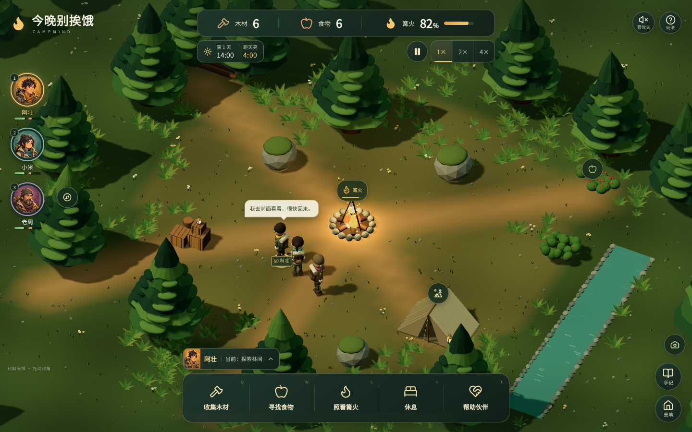

# 今晚别挨饿 · CampMind

一个由真实本地小模型参与 NPC 决策的 **3D 营地生存游戏**。照顾阿壮、小米、老周三位伙伴，安排采集、添柴和休息，在风雨中一起等到天亮。Three.js 创建立体森林、营地与角色，React + TypeScript 提供手机优先的全屏浮动界面，支持鼠标、键盘和触摸操作。



[查看移动端界面](docs/screenshots/mobile.png) · [3D 与手机布局设计](docs/design/mobile-3d.md) · [玩法设计](docs/design/game-spec.md) · [模型卡](docs/model-card.md) · [实测评估](docs/evaluation.md) · [验证记录](docs/validation.md)

## 快速开始

需要 **Node.js 22.12+ 和 npm**。游戏已经附带训练好的权重，本地模型无需 Python、推理服务器或 API 密钥；立体画面需要支持 **WebGL 2** 的浏览器。

在仓库根目录执行：

```bash
npm ci
npm run dev
```

打开终端显示的 localhost 地址。构建并检查生产版本：

```bash
npm run build
npm run preview
```

`dist/` 是可由静态服务器提供的完整构建。部署时使用 HTTPS；本地开发和预览使用 localhost。模型完整性校验与离线缓存需要浏览器的安全上下文。

## 怎么玩

每局最多 **240 个模拟秒**，1× 速度下约 4 分钟，可以暂停或切换 1× / 2× / 4×。三档难度分别为「悠然露营」「荒野求生」「凛夜挑战」。新旅程中的「模型与场景设置」可以选择本地模型或规则策略、初始场景和世界种子。

1. **选中伙伴，再安排工作。** 点击头像或地图上的人物，再点任务按钮或地图地点。伙伴会权衡饥饿、体力、危险、信任和性格；任务指令不保证立即被执行。
2. **保持物资周转。** 采集物资需要送回储物区，添柴会消耗木材。饥饿时分配食物，疲劳时允许休息，受伤时安排同伴帮助。
3. **留意脚下。** 普通任务会自动绕开实体和危险地带；点击空地可让选中伙伴临时走到那里。主动靠近火焰、荆棘、溪水或撞上岩石，会引起相应的伤害与反应。
4. **最后半分钟召回。** 打开「营地」并点击「全队回营」，同时继续留意篝火和队员状态。风雨会加快燃料消耗。

**胜利条件：** 到达 240 秒时三人都存活、篝火未熄灭，且每人距篝火小于 25 个游戏单位。任何人倒下或篝火熄灭都会立即失败；天亮时仍有人在安全圈外也会失败。

| 操作 | 效果 |
| --- | --- |
| 点击 / 触摸头像或地图人物 | 选择伙伴 |
| 点击场景空地 | 临时移动到该位置，完成或受阻后恢复自主任务 |
| 拖动场景 / 双指缩放 | 旋转视角 / 调整远近 |
| `1` / `2` / `3` | 选择阿壮 / 小米 / 老周 |
| `Q` / `W` / `E` | 采集木材 / 采集食物 / 照看篝火 |
| `R` / `T` | 休息 / 帮助同伴 |
| 空格或暂停按钮 | 暂停 / 继续 |
| 底部伙伴名字或「营地」 | 鼓励、催促、分食、自主安排、物资优先级、全队回营 |
| 「手记」或「营地」中的「决策观察」 | 检查并导出真实决策记录 |

暂停时可以安排任务，恢复后伙伴继续行动。页面切到后台会自动暂停并尝试保存；音效默认关闭，可在顶部开启。

## 立体场景、碰撞与声音

场景中的角色、树木、岩石、帐篷、木堆和篝火都是 Three.js 网格。场景铺满屏幕，资源与时间位于顶部，头像贴边，五个主要任务放在底部拇指区域；沟通、设置与记录收进可关闭的窗口。手机竖屏、横屏与桌面共享同一局状态。

碰撞与渲染共用 `src/game/terrain.ts` 的坐标和尺寸。人物使用圆形体积，树、岩石与篝火使用圆形碰撞，帐篷、储物区与溪水使用矩形区域；移动经过连续扫掠、滑动与同伴分离处理。普通任务会规划安全路线，并站在物体外侧工作，避免直接走进火心。引擎保持确定性的地面运动，不包含跳跃、重力坠落、布娃娃或可推动刚体。

| 接触对象 | 游戏反应 |
| --- | --- |
| 篝火 | 灼伤、健康下降、恐惧上升，受伤后退开 |
| 荆棘 | 刺伤、受伤标记与来源对应的抱怨 |
| 岩石 | 达到撞击速度阈值后擦伤；普通轻触只阻挡 |
| 溪水 | 寒冷打滑，消耗体力并受到少量伤害 |
| 树木、帐篷、储物与同伴 | 阻挡或避让，普通碰撞不随意扣血 |

受伤会驱动身体动作、受伤标记、气泡和事件记录，并改变模型能观察到的健康、恐惧、伤情等状态。每个对象与每名伙伴都有冷却，不能在重叠时每帧扣血或无限排队说话。

开启音效后，浏览器会本地合成与伤害来源、角色音高对应的短促叫声。完整中文牢骚使用设备已安装的本地中文语音；设备未提供该语音时仍播放叫声并显示中文气泡，不请求远程语音服务。台词按角色与危险对象选择模板。静音、暂停、切入后台和重开都会停止旧声音与尚未开始的语音。

## 真实本地 AI

| 项目 | 实现 |
| --- | --- |
| 模型 | 使用本仓库合成状态实际训练的专用多层感知机（MLP） |
| 网络 | **36 → 64 → 48 → 8 + 5**，ReLU 隐藏层，动作与情绪双输出头 |
| 参数 | **6,125** |
| 权重 | **24,500 字节**，Float32 little-endian，位于 `public/models/policy.f32` |
| 输入 | 36 个归一化状态特征，包含身体状态、人格、物资、天气、同伴情况和任务指令 |
| 输出 | 8 种动作、5 种情绪；动作受引擎提供的合法动作 mask 约束 |
| 推理 | 浏览器本地 JavaScript 矩阵计算，加载时验证清单、形状、有限数值和 SHA-256 |

**它不是 LLM，也不理解自由中文指令。** 台词来自游戏模板；人格、关系和世界状态由模拟器保存。24,500 字节只计算权重文件，整款游戏资源、浏览器内存和临时激活另计。

规则模式直接使用训练时的同一套 teacher 策略。这个项目用于观察一个极小网络如何模仿受约束的决策，**不声称它优于规则，也不保证复杂社交能力或整局胜利**。模型加载失败会显示错误，可以重试或明确切换规则模式；推理异常引发的回退会记录在决策面板中。

## 重新训练

仅复训需要 **Python 3.11+、NumPy 2.3.5**；依赖固定在 `requirements.txt`，可在自己的虚拟环境中安装：

```bash
python -m pip install -r requirements.txt
npm run train
```

也可直接运行 `python scripts/train_policy.py`。默认训练种子为 `20261012`，会重新生成 `public/models/` 中的权重、manifest 与 NumPy / JavaScript 对照样本。可用 `python scripts/train_policy.py --help` 查看训练规模和输出目录参数。

训练使用合成状态与 teacher 监督，不依赖外部预训练权重。数据划分、离线准确率、数值一致性和复现环境见[模型卡](docs/model-card.md)；分类准确率不等于游戏胜率。

## 测试与实际回合评估

```bash
npm test
npx playwright install chromium
npm run build
npm run test:e2e
```

`npm test` 运行 Vitest 测试。首次运行 Playwright 浏览器测试前，先执行上面的 Chromium 安装命令；E2E 测试会自动启动生产预览服务器，因此每次修改代码后先执行 `npm run build`。受限运行环境也可通过 `PLAYWRIGHT_CHROMIUM_EXECUTABLE` 指定已安装的 Chromium。

```bash
npm run evaluate
npm run evaluate -- --output ./evaluation.json
```

默认评估 **14 局真实引擎回合**：seed 7 的 3 场景 × 2 难度 × 2 策略共 12 局无人指挥，再加 2 局固定危机的救援对照。所有回合使用 **0.1 秒固定 tick**，与界面加速时重复执行的步长一致。

终端显示结局、得分、存活、火势、健康、回退、决策耗时与命令数量；`--output` 导出完整 JSON，默认不写文件。报告中的延迟来自 Node.js 进程，浏览器中的实际决策耗时可在游戏面板查看。样本数量、逐局结果、真实救援命令与比较限制见[评估说明](docs/evaluation.md)。

## 存档、种子与 JSON 记录

- **自动保存：** 游戏约每 3 秒尝试保存到当前浏览器、当前站点的 `localStorage`，离开页面时也会尝试保存。再次打开可选「继续上一次旅程」；新旅程会替换当前存档。
- **同种子对照：** 新旅程可复用种子并切换策略。重现还需要相同的场景、难度、模型与引擎版本、指令及其时机；单独相同的种子不保证两种策略得到相同结局。
- **决策观察：** 打开面板会暂停，能检查实际输入、合法动作、归一化偏好、执行动作、情绪、来源与耗时。显示的分数是动作偏好，不是成功概率或自然语言思考过程。
- **导出真实记录：** 面板导出当前局最近 **180 条决策、80 条事件**，以及种子、设置、统计和 NPC 状态。CLI 评估报告另含完整的实际命令序列及生效反馈。

## 离线使用

1. 先运行 `npm run build`，通过 HTTPS 静态站点或 localhost 预览打开生产构建。
2. 首次保持联网，打开 **「营地」** 并等待显示 **「离线资源已备妥」**，确认该版本的页面、脚本、模型、画面和本地字体已完整缓存。
3. 完成后可断网，使用同一地址继续或重新打开游戏。浏览器清理了站点缓存后，需要重新联网完成缓存。

生产构建会生成包含确切资源清单和版本的 Service Worker；**开发模式不注册 Service Worker**。首次未完成缓存就断网，不能视为已具备离线条件。存档与离线资源缓存分别保存，浏览器禁止本地存储时，界面会提示无法保存进度。

## 源码与资源

| 路径 | 内容 |
| --- | --- |
| `src/App.tsx`、`src/components/`、`src/hooks/` | 游戏界面、任务交互、固定 tick 与浏览器集成 |
| `src/game/` | 纯状态模拟、资源与事件、观察值、存档校验、合成音效 |
| `src/scene/` | Three.js 场景、立体角色、相机、地面拾取与动画 |
| `src/ai/` | 模型加载与推理、teacher 规则基线 |
| `scripts/train_policy.py` | NumPy 训练与模型导出 |
| `scripts/evaluate.ts` | 实际回合评估与 JSON 报告 |
| `scripts/generate-sw.mjs`、`public/sw.js` | 生产资源清单与离线缓存 |
| `public/models/` | 二进制权重、manifest、数值对照样本 |
| `public/assets/`、`src/styles/` | 地图、角色、本地字体与响应式样式 |
| `tests/`、`docs/` | 自动化验证、设计、模型卡、评估与界面截图 |

本地字体为 **Noto Sans SC**，使用 Fontsource 提供的字形子集，遵循 **SIL Open Font License 1.1**；原许可证见 [`public/assets/fonts/LICENSE`](public/assets/fonts/LICENSE)。

原始营地图 `camp.png`、继续用于头像的角色图集 `characters.png` 和设计概念图由本项目使用 **Image Gen** 生成。提示词与来源记录在[美术说明](docs/design/asset-prompts.md)。当前可玩场景与角色由 Three.js 几何体构建；HUD、文字、按钮、进度条、选择标记和天气表现由代码实现。
