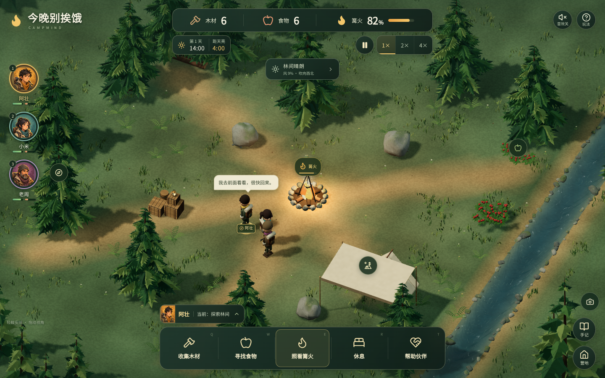

# 今晚别挨饿 · CampMind

## Unity 编辑器入口（迁移工程）

在本仓库根目录双击 **`打开Unity编辑器.cmd`**。实际 Unity 工程位于 `native/CampMind.Unity`，使用 Unity `6000.3.26f1`，启动后打开 `Assets/CampMind/Scenes/Camp.unity`。

本机从 Hub 直接启动曾崩溃于可选的 BuildReport REST 服务（`Mono wakeup_pipes_init`）。上述入口在编辑器运行期间保留 IPv4/IPv6 本地回环端口38000，并跟踪启动时的进程交接；不关闭 VPN/TUN，不修改 Unity 安装文件。重复启动不会再开一个工程实例。启动记录位于 `native/Artifacts/editor`。

本机 Windows UAC 关闭，Unity 会显示管理员权限提示；当前入口没有改变系统权限配置。如接受当前管理员身份，选择 **Ignore Warning** 继续。受限令牌启动的尝试未通过 Unity 实测，已撤回，不能宣称本入口提供普通用户启动。直接从 Hub 打开仍不会启动端口保护，请使用上面的工程入口。入口会在退出/重启时保留最多30秒的交接保护，并兼容 Hub 小写 `-projectpath` 参数；失败时先释放端口再显示错误。

当前 Editor Play 是场景预览；连接隔离 TS 权威服务的游戏样板使用 `pwsh scripts/unity/play.ps1`。完整 C# 游戏迁移进度见 [迁移记录](docs/unity-migration/progress.md)。下方保留原 Web 实现说明。

一个由真实本地小模型参与 NPC 决策的 **桌面 3D 村寨生存游戏**。领主照顾九名性格各异的属民，安排寨外采集、仓库补给、互助和回屋休息。口粮低于按人数和往返路程计算的生存线时，优先补粮；人物仍保留各自的性格、持续诉求、记忆和分工意见。Three.js 创建村寨、荒野与角色，React + TypeScript 提供鼠标与键盘操作的桌面界面。



[五人营地](docs/screenshots/social-five-crew.png) · [手机对话界面](docs/screenshots/social-mobile.png) · [NPC 升级与验证](docs/validation-npc.md) · [五人回合历史评估](docs/evaluation-social.md) · [森林与水雨细节](docs/design/natural-detail.md) · [3D 与手机布局设计](docs/design/mobile-3d.md) · [模型卡](docs/model-card.md)

## 快速开始

需要 **Node.js 24+ 和 npm**。游戏已经附带 MLP 决策权重，基础游戏无需 Python 或 API 密钥；MiniMind3 台词通过浏览器 Worker + WebAssembly 本地运行。独立本机世界服务将进度保存到 SQLite，关闭网页后仍继续推进。立体画面需要支持 **WebGL 2** 的浏览器。详见 [存档与持续世界](docs/persistent-world.md)。

在仓库根目录执行：

```bash
npm ci
npm start
```

打开终端显示的 localhost 地址。`npm start` 同时启动网页和世界后台，在启动终端按 Ctrl+C 或在另一终端执行 `npm stop` 会一起停止。重启使用 `npm stop` 后再 `npm start`，不会清空存档。旧版启动留下的同项目后台也可用 `npm stop` 清理；启动时不会静默复用旧后台。直接使用 `npm run dev` / `npm run world` 是独立服务调试入口。

构建并检查生产版本：

```bash
npm run build
npm run preview
```

启用 **MLP 决策 + MiniMind3 后台台词**，在同一仓库根目录执行：

```bash
# 准备 WASM 运行文件和固定版本 GGUF；已有本地权重会校验后复用
npm run npc:setup
npm start
```

游戏场景加载完成后自动后台下载同源模型资源，校验 SHA-256，再保存到独立本地缓存并加载 WASM。人物立即行动，现有反馈先显示，台词生成后更新；相同状态的备用句可直接从缓存显示。在「营地」→「伙伴台词」查看下载、校验、加载、缓存和耗时。关闭或模型失败时继续使用即时回应。首次克隆的基础构建可不携带模型；启用台词时运行上述准备命令，再构建并部署整个 `dist/`（包含独立 GGUF 资源）。模型不纳入游戏首屏离线预缓存，不阻挡进入游戏。

**游戏不再调用 `/npc-api`，不启动 Python/DLL 服务。** WASM 和兼容运行文件随构建发布，无运行时 CDN 依赖；权重不提交 GitHub。当前验证范围是网页游戏，微信/抖音小游戏仍需各自的 Worker、文件系统、WASM API 适配及手机真机验证，不能直接把网页构建当作小游戏发布包。详见 [MiniMind3 接入说明](minimind3/INTEGRATION.md)。

`dist/` 提供前端资源，游玩还需要独立世界服务与 `/game-api` 同源代理；`npm run preview` 会自动准备。模型加载、SHA-256 校验和本地推理在普通 HTTP 下也能运行，缺少 WebCrypto 时使用纯 JavaScript 回退。**Service Worker 资源缓存仍需 HTTPS 或 localhost**；已缓存资源不代表世界服务离线时还能操作。

## 怎么玩

世界持续运行，**没有 240 秒结束限制**，可以暂停或切换 1× / 2× / 4×。三档难度为「悠然村居」「村寨求生」「严酷生存」。新旅程可选择本地模型或规则策略、初始场景和世界种子。

1. **选中伙伴，再安排工作。** 点击头像或地图上的人物，再点任务按钮或地图地点。伙伴会权衡饥饿、体力、危险、信任和性格；任务指令不保证立即被执行。
2. **先保口粮。** 采集物资必须送到实际仓库才入库，自动领餐也在仓库进行。低于生存库存时，优先补到较高目标线；在途补给避免重复派工。篝火只作景物。
3. **留意脚下与寨门。** 普通任务会绕开实体和危险地带，经寨门和桥梁出入。荆棘、溪水与高速撞上岩石仍可能造成伤害，关闭寨门会阻断通行。
4. **回屋休息，到广场集合。** 每人使用自己的民居；「全员回寨」到村寨广场集合，携物者先送仓。紧急进食、重伤和耗尽体力仍优先处理。

**持续生存：** 世界永不自动结算或结束；1 倍速每 600 秒一日，白天 420 秒、夜晚 180 秒。伙伴死亡仅影响该角色，其他伙伴、昼夜、天气与领主控制继续运行，全员死亡也不会停止世界。旧版胜利/失败存档恢复为可继续的暂停状态，保留死亡与历史，不补算结束期间的时间。篝火仅作环境展示：木材大于 0 时亮起，否则熄灭；无需添柴，不影响健康、士气、任务安排或评分，也不会灼伤伙伴。

| 操作 | 效果 |
| --- | --- |
| 点击 / 触摸头像或地图人物 | 选择伙伴 |
| 点击场景空地 | 临时移动到该位置，完成或受阻后恢复自主任务 |
| 拖动场景 / 双指缩放 | 旋转视角 / 调整远近 |
| `1` / `2` / `3` / `4` / `5` | 选择阿壮 / 小米 / 老周 / 林枫 / 阿野 |
| `Q` / `W` | 采集木材 / 采集食物 |
| `R` / `T` | 休息 / 帮助同伴 |
| 空格或暂停按钮 | 暂停 / 继续 |
| 底部伙伴名字或「营地」 | 鼓励、催促、分食、自主安排、物资优先级、全员回寨 |
| 「回应伙伴请求」或「营地」→「主动聊聊」 | 商量分工、分食、安全、分歧和承诺，作出实际安排 |
| 「手记」或「营地」中的「决策观察」 | 检查并导出真实决策记录 |
| 顶部天气标签 | 查看天气、雨棚和人物淋湿状态；主动触发山风、阵雨、雷暴或放晴 |
| 顶部「音效关」或天气窗口中的「听见这片营地」 | 开启本地环境声与角色音效；关闭窗口，回到运行中的场景聆听 |

暂停时可以安排任务，恢复后伙伴继续行动。切页不再暂停，关闭网页后世界继续运行并存入 SQLite；重开读取最新进度。手动暂停持久生效，对话窗口的临时暂停在页面断开后到期。音效默认关闭，可在顶部开启。

## 玩家与伙伴一起安排营地

开局后会出现分工交流，之后的诉求由实际饥饿、工作负担、天气、伤员和分工差距触发。同一轮需要不会冷却后反复重新提出；被拒绝会留在记忆里，推动忍耐、协商、拒绝或实际休息。点任务栏上方的小提示回应，也可以在「营地」中主动聊聊。对话窗暂停模拟，关窗恢复先前状态，同时最多保留两件未处理请求。

选项按话题和当前状态检查库存、人手与安全，并提供明确拒绝和核查说辞等处理方式。**分食实际消耗库存；换班需要真正有人执行；照顾指定伤员必须确实照顾那个人；探索只约定一趟，超时会返营。** 送货途中优先把物资送回。任务按钮、社交安排和手动移动都会尊重已经形成的停工与恢复意图。

可以承诺在 **45 个模拟秒内**让某人吃到食物或完成一次休息。答应时不奖励信任；实际分食、完成进食或完成休息才算兑现。超时会留下当事人的失约记忆，之后补救不会改写过去。暂停冻结期限，夜晚剩余时间不够时不能再作出新承诺。对话选择记录一次，重复点击无额外收益；做完安排后先回到营地推进一小段行动，再继续商量。

玩家可以输入最多 160 字的表达；清晰的“去休息”“继续干活”“不许休息”“对不起”等会通过营地指令识别影响态度或安排，疑问、引述和歧义句只作为交流。MiniMind3 读取已经形成的立场、公开说辞、近期双方对话、持续诉求与亲历记忆进行表达，不负责决定或完成任务。台词区区分「即时回应」「MiniMind3」与「模型缓存」。过期回复不能覆盖后来已经改变的立场；模型不可用时，性格差异和实际行为仍完整运行。

伙伴档案展示性格、当前负担与不满、你们的承诺、其本人记得的经历，以及对其他伙伴的有向关系。实际互助会改善受助者对帮助者的关系，未解决的分工问题会带来不满；没有参与或获知的私人经历不会被随意塞进另一个人的对话上下文。

## 五位伙伴

| 伙伴 | 性格与关注点 |
| --- | --- |
| 阿壮 | 勇敢、行动迅速，愿意先承担危险与体力活 |
| 小米 | 谨慎、留意环境，需要风险说明和安全感 |
| 老周 | 老油条、自利、低诚实；会挑轻活、低投入磨洋工、找借口和推责，利益合适也会合作 |
| 林枫 | 懒惰、偏激、冲动；可能直接拒工、擅自休息，受挫后尝试拉拢有共同不满的伙伴 |
| 阿野 | 好奇、重视自主，喜欢探索，也会对被持续催促提出意见 |

五人共用同一份任务策略权重，原有三项人格参数仍用于 MLP；九项连续人格参数则用于通用心智裁决。人格决定倾向，身体与经历改变当前状态，不将 MBTI 类型当作固定行为脚本。内部 ID `linlan` 为兼容旧存档保留，当前显示名是林枫。集体反抗在本版表现为公开串联和共同停工，每人依据自己知道的情况独立加入或退出。

## 在下一个游戏复用 NPC

设计先于实现，接口与迁移约定见 [架构设计](docs/superpowers/specs/2026-10-13-reusable-npc-design.md) 和 [实施计划](docs/superpowers/plans/2026-10-13-reusable-npc.md)。

| 模块 | 下个游戏可以直接复用 | 宿主需要提供 |
| --- | --- | --- |
| `packages/npc-core` | 性格、情绪评估、事件去重、持续诉求、意图、动作评分、同伴响应 | 人物配置、模拟秒、已知情况、合法动作与事件，按返回结果执行世界行为 |
| `packages/npc-dialogue` | 对话队列、优先级、缓存、取消、重试、过期结果隔离、提示词编排 | 对话桥接、时钟/取消能力、语言后端、领域文字校验和即时表达 |
| `src/integrations/minimind` | 浏览器 MiniMind worker、模型校验与缓存、推理取消 | 已构建的通用提示和同源资源地址 |

两个通用包是 **TypeScript 源码包**，公开入口均为 `src/index.ts`，没有 npm 发布或预编译 JavaScript 的假设。可复制目录到下一款 TypeScript 游戏，或配置工作区后引用。详细单位、字段所有权和接口示例见各包 README；[餐厅示例](examples/restaurant/index.ts) 直接使用相同核心，把动作换成备餐、上菜与休息，不导入营地代码。

```bash
npm run check:npc   # 各包独立 ES2022/noDOM 类型检查 + 禁止反向依赖
npx vitest run tests/npc-core.test.ts tests/npc-dialogue.test.ts
```

心智只返回选择与投入比例，宿主执行器负责再次核验、推进进度和结算物资。NPC 的公开谎话只掩饰动机，不能伪造工作已经完成。通用包不访问系统时间、地图、React 或游戏存档；所有新扩展点与关键状态转换均附中文注释。

## 会影响选择的天气

晴朗、山风、阵雨与雷暴由世界种子确定，开局约 10–15 个模拟秒就会遇到第一次变化，后续每轮约 20–35 秒。风力、风向、雨量与云量逐渐变化；切换天气时，风会连续转向、缓缓增强或减弱。雷暴里的闪电、雷声和人物反应来自同一次模拟事件。暂停会冻结天气，静音或进入后台会停止环境声音。

天气窗口中的 **「风吹向东南」表示风正在往东南吹**；罗盘以地图为准，始终北在上方，不随相机旋转。树梢、雨线、火烟和布料读取同一风向，河流则沿河道向南流动。

| 环境变化 | 场景表现与实际影响 |
| --- | --- |
| 风 | 树根固定、树干逐渐弯曲，树冠错开节奏摆动；可见树形、光照和阴影同步变化 |
| 雨 | 斜向雨丝、落地雨点和雨棚排水；露天人物逐渐淋湿，体力与情绪受影响 |
| 雷暴 | 云层变暗、闪电和本地合成雷声；暴露的伙伴受惊并重新权衡任务 |
| 篝火 | 火焰上端随风弯曲，轻烟与火星先上升再向下风偏移；雨中有少量蒸汽，无木材时火焰、灯光和粒子一起熄灭，有木材自动亮起 |
| 民居和有顶公共屋舍 | 实际屋顶提供遮蔽，完整度影响暴露；广场位于寨内，但不提供雨棚保护 |
| 河流 | 水面、河岸、地形下凹与危险区域贯穿地图两端；水纹和泡沫向南流，河心快、近岸慢，风雨只扰动表面 |

天气变化会请求一次**真正的策略推理**。系统不会把“雷暴时休息”写成强制动作，天气也不会直接禁用户外动作。MLP 自己输出偏好，再从真实合法动作中选择；继续原任务时保留其进度，玩家手动移动和已携物资返程得到保护。

要观察效果，可选中小米，点击天气标签并触发“唤来雷暴”，随后留意动作和气泡，再打开“决策观察”。记录中有当时的风雨、雷暴风险、淋湿与暴露程度、雨棚完整度、前一任务、本次选择和真实来源。当前测试中，其他状态与合法动作相同的谨慎角色会从晴天采食变为雷暴时休息；篝火不再参与任务决策，旧模型的添柴输出被合法动作过滤。具体游戏选择还受物资、体力、指令和同伴分工影响。

当前交付的是重新训练的 v3 生存库存 MLP。即时气泡表达实际执行的任务；后台语言模型共享村寨、住宅、仓库、寨门与口粮事实。旧帐篷说法和未实现的练武、锻造、交易不会作为当前行为显示；在途回复还需通过世界与任务指纹校验。

## 立体场景、碰撞与声音

场景中的角色、民居、仓库、寨墙、树林与篝火均由 Three.js 展示。资源与时间位于顶部，人物状态、沟通、设置和记录使用桌面浮动窗口；以鼠标与键盘操作验收。

森林以原始 2D 概念图的细密层次为参照：有纹理的树干、下垂松枝和分离针尖共同组成树冠，林下混合弯曲草叶、羽状蕨叶、三叶草、小花和落针。泥土、木材、岩石与帆布采用本地程序纹理，雨中逐渐变暗并改变粗糙度。溪水包含深浅水色、细小反光、顺流碎沫与雨点涟漪，河岸用大小不一的湿石打散轮廓。雨丝随风倾斜；棚面水花、雨滴终点与檐口排水读取实际变形后的布面。各层仍可从不同方向观察，随游戏时间和天气联动。

碰撞与渲染共享权威地理数据。人物使用圆形体积，房屋、仓库门洞、寨墙与补给箱均有实际碰撞；入库和领餐的九个站位位于仓库内。移动经过路线规划、连续扫掠、滑动与同伴分离处理。引擎保持确定性的地面运动。

河水、树木、布料与火烟采用**轻量物理表现近似**：预设河道流速、根部锚定的曲线变形，以及数量受限的短生命周期粒子。完整流体、柔体或刚体动力学求解不在实现范围。动画跟随游戏时间，暂停后保持相位；系统开启「减弱动态效果」时保留稳态风压，停止持续摆动与流动动画。

| 接触对象 | 游戏反应 |
| --- | --- |
| 篝火 | 只作景物和实体阻挡，不灼伤或影响生存 |
| 荆棘 | 刺伤、受伤标记与来源对应的抱怨 |
| 岩石 | 达到撞击速度阈值后擦伤；普通轻触只阻挡 |
| 溪水 | 寒冷打滑，消耗体力并受到少量伤害 |
| 树木、房屋、仓库补给箱与同伴 | 阻挡或避让，普通碰撞不随意扣血 |

受伤会驱动身体动作、受伤标记、气泡和事件记录，并改变模型能观察到的健康、恐惧、伤情等状态。每个对象与每名伙伴都有冷却，不能在重叠时每帧扣血或无限排队说话。

声音默认关闭。点击顶部「音效关」，或在天气窗口点击「听见这片营地」，即可开启 **风声、树叶沙沙声、雨声、溪水声、篝火噼啪声** 五层本地合成环境声。关闭窗口并继续旅程后，声音会随天气和实际火势调整；靠近溪流或篝火时，相应声音更清楚。

**聆听位置跟随选中的伙伴，左右声道跟随当前相机。** 切换伙伴、让伙伴移动或旋转视角，都能改变听到的远近与方向。雷声依据同次闪电到伙伴的距离估算延迟、响度和滚雷尾音；这是微缩地图的声学近似，不使用远程音频服务。

浏览器还会本地合成与伤害来源、角色音高对应的短促叫声。完整中文牢骚使用设备已安装的本地中文语音；设备未提供该语音时仍播放叫声并显示中文气泡。台词按角色与危险对象选择模板。静音、暂停、切入后台和重开都会停止环境声、旧音效、排队雷声与尚未开始的语音，恢复后不会补播历史雷击。

## 真实本地 AI

| 项目 | 实现 |
| --- | --- |
| 模型 | 使用本仓库合成状态实际训练的专用多层感知机（MLP） |
| 网络 | **44 → 64 → 48 → 8 + 5**，ReLU 隐藏层，动作与情绪双输出头 |
| 参数 | **6,637** |
| 权重 | **26,548 字节**，Float32 little-endian，位于 `public/models/policy.f32` |
| 输入 | 保留前 41 项顺序，追加生存库存覆盖率、预计补给覆盖率和补粮派工需求 |
| 输出 | 8 种动作、5 种情绪；动作受引擎提供的合法动作 mask 约束 |
| 推理 | 浏览器本地 JavaScript 矩阵计算，加载时验证清单、形状、有限数值和 SHA-256 |

**MLP 不理解自由中文指令。** 村寨适配识别明确文字安排，通用心智保留合作与个人动机，生存仲裁保障实际任务。语言模型只表达当前状态；规则覆盖会记录实际来源和原因。对话模型的权重独立于这份 26,548 字节的决策权重。

**九人村寨使用 44 维观测与 v3 权重。** 原索引 18–22 仍保留半人数计数单位；新增库存特征负责人数与路程需求。训练覆盖九名属民的性格范围、长距离出行和补粮延续状态。旧版 36/41 维历史记录可读取，但旧模型不能混用新观测。

规则模式直接使用训练时的同一套 teacher 策略。这个项目用于观察一个极小网络如何模仿受约束的决策，**不声称它优于规则，也不保证复杂社交能力或整局胜利**。模型加载失败会显示错误，可以重试或明确切换规则模式；推理异常引发的回退会记录在决策面板中。

## 重新训练

仅复训需要 **Python 3.12、NumPy 2.5.3**；依赖固定在 `requirements.txt`，可在自己的虚拟环境中安装：

```bash
python -m pip install -r requirements.txt
npm run train
```

也可直接运行 `python scripts/train_policy.py`。默认种子为 `20261015`、80 轮，会同时重新生成权重、manifest 与 NumPy / JavaScript 对照样本。精确训练环境以 manifest 为准；不同 NumPy/BLAS 版本可能有数值差异。

训练使用合成状态与 teacher 监督，不依赖外部预训练权重。数据、准确率和环境见[模型卡](docs/model-card.md)；真实多日库存与存活验收见[村寨 NPC 验收记录](docs/validation-village-npc-alignment.md)。运行 `npm run evaluate:survival -- --seeds=17,41,7 --seconds=1800` 可复测三个游戏日；分类准确率不等于游戏存活保证。

## 测试与实际回合评估

```bash
npm test
npm run check:npc
npx playwright install chromium
npm run build
npm run test:e2e
```

`npm test` 运行 Vitest 测试。首次运行 Playwright 浏览器测试前，先执行上面的 Chromium 安装命令；E2E 测试会自动启动生产预览服务器，因此每次修改代码后先执行 `npm run build`。受限运行环境也可通过 `PLAYWRIGHT_CHROMIUM_EXECUTABLE` 指定已安装的 Chromium。

```bash
npm run evaluate
npm run evaluate -- --output ./evaluation.json
```

默认评估 **14 局真实引擎回合**：seed 7 的 3 场景 × 2 难度 × 2 策略共 12 局无人指挥，再加 2 局固定危机的救援对照。所有回合使用 **0.1 秒固定 tick**，与界面加速时重复执行的步长一致。

终端显示结局、得分、存活、火势、健康、回退、决策耗时与命令数量；`--output` 导出完整 JSON，默认不写文件。报告中的延迟来自 Node.js 进程，浏览器中的实际决策耗时可在游戏面板查看。样本数量、逐局结果、真实救援命令与比较限制见[评估说明](docs/evaluation.md)。

## 存档、种子与 JSON 记录

- **自动保存：** 游戏约每 3 秒尝试保存到当前浏览器、当前站点的 `localStorage`，离开页面时也会尝试保存。再次打开可选「继续上一次旅程」；新旅程会替换当前存档。
- **同种子对照：** 新旅程可复用种子并切换策略。重现还需要相同的场景、难度、模型与引擎版本、指令及其时机；单独相同的种子不保证两种策略得到相同结局。
- **决策观察：** 打开面板会暂停，能检查实际输入、合法动作、归一化偏好、执行动作、情绪、来源与耗时。显示的分数是动作偏好，不是成功概率或自然语言思考过程。
- **导出真实记录：** 面板导出当前局最近 **180 条决策、80 条事件**，以及种子、设置、统计和 NPC 状态。CLI 评估报告另含完整的实际命令序列及生效反馈。
- **人物与心智迁移：** 旧三人和五人存档统一更新为当前静态人物配置，保留身体、在途任务、资源、事件原文和决策数值；缺少心智时初始化空记忆，不把历史累计拒绝次数伪造为同一诉求的拒绝经历。新档保存情绪、诉求阶段、意图、投入与事件游标；未知未来心智版本保留原档，不当成损坏删除。旧三人存档补入林枫和阿野；已有新存档名单缺损不能冒充旧档。
- **历史兼容：** 更早的存档补齐天气与淋湿字段，旧 36/41 维决策保留原始数值和版本；新决策采用 44 维 v3。村寨布局 v8 将待领餐、返仓和广场集合目的地迁到当前设施，保留库存、人格、死亡与历史记录；不会通过迁移赠粮或复活。

## 离线使用

1. 先运行 `npm run build`，通过 HTTPS 静态站点或 localhost 预览打开生产构建。
2. 首次保持联网，打开 **「营地」** 并等待显示 **「离线资源已备妥」**，确认该版本的页面、脚本、模型、画面和本地字体已完整缓存。
3. 完成后可断网，使用同一地址继续或重新打开游戏。浏览器清理了站点缓存后，需要重新联网完成缓存。

生产构建会生成包含确切资源清单和版本的 Service Worker；**开发模式不注册 Service Worker**。首次未完成缓存就断网，不能视为已具备离线条件。存档与离线资源缓存分别保存，浏览器禁止本地存储时，界面会提示无法保存进度。

## 源码与资源

| 路径 | 内容 |
| --- | --- |
| `src/App.tsx`、`src/components/`、`src/hooks/` | 游戏界面、任务交互、固定 tick 与浏览器集成 |
| `src/games/camp/simulation/` | 纯状态模拟、资源与事件、观察值、存档校验、合成音效 |
| `src/scene/` | Three.js 场景、立体角色、相机、地面拾取与动画 |
| `packages/npc-core/`、`packages/npc-dialogue/` | 跨游戏复用的心智与对话源码包 |
| `src/games/camp/npc/`、`src/games/camp/dialogue/` | 五人配置、营地观察与执行适配、中文命令和表达、对话提交 |
| `src/games/camp/ai/` | 现有营地 MLP 加载、推理和 teacher 规则基线 |
| `src/integrations/minimind/`、`src/shared/crypto/` | 浏览器语言模型后端与独立校验工具 |
| `examples/restaurant/` | 使用相同核心的第二游戏最小适配 |
| `scripts/train_policy.py` | NumPy 训练与模型导出 |
| `scripts/evaluate.ts` | 实际回合评估与 JSON 报告 |
| `scripts/generate-sw.mjs`、`public/sw.js` | 生产资源清单与离线缓存 |
| `public/models/` | 二进制权重、manifest、数值对照样本 |
| `public/assets/`、`src/styles/` | 地图、角色、本地字体与响应式样式 |
| `tests/`、`docs/` | 自动化验证、设计、模型卡、评估与界面截图 |

本地字体为 **Noto Sans SC**，使用 Fontsource 提供的字形子集，遵循 **SIL Open Font License 1.1**；原许可证见 [`public/assets/fonts/LICENSE`](public/assets/fonts/LICENSE)。

NPC 持续记忆会记录行动、自言自语、玩家交流与当面伙伴交流，并参与性格化的协商、拒工和集体诉求。认知默认开启，自动跟随当前实际使用的对话模型，无需另选：本地 Qwen 生效时使用相应原生认知模型，未选优先模型或回退时使用内置 MiniMind3。游戏运行无需远程 API；远程模型入口仅供测试。认知失败时继续心智策略。记忆存储、迁移备份、罢工执行边界和验证结果见 [NPC 记忆与社会自主行为验证](docs/validation-npc-memory-agency.md)。

原始营地图 `camp.png`、继续用于头像的角色图集 `characters.png` 和设计概念图由本项目使用 **Image Gen** 生成。提示词与来源记录在[美术说明](docs/design/asset-prompts.md)。当前可玩场景与角色由 Three.js 几何体构建；HUD、文字、按钮、进度条、选择标记和天气表现由代码实现。
