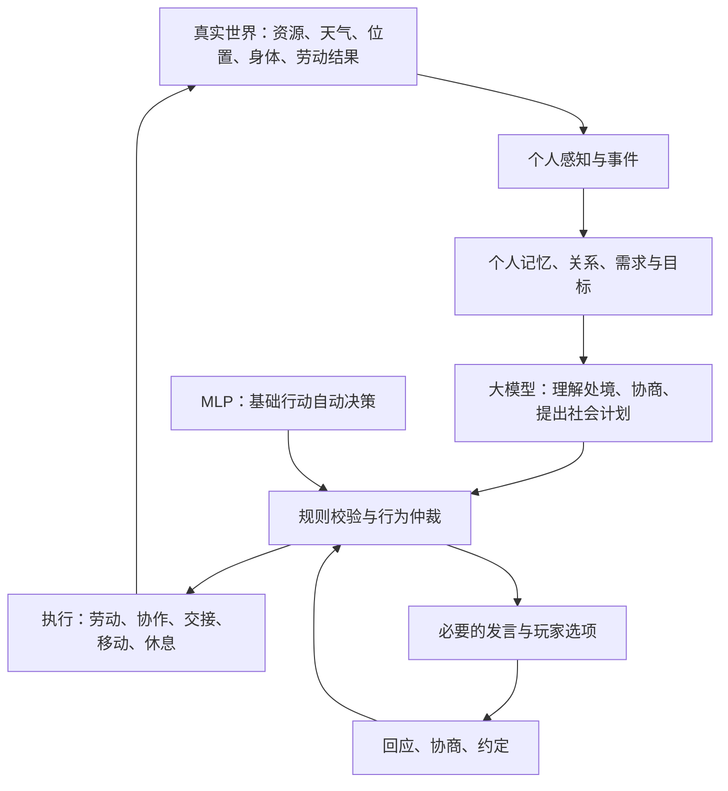

# CampMind 大模型游戏社会架构完整设计

日期：2026-10-16  
目标平台：桌面游戏  
文档性质：目标架构设计，包含已有基础与待建设能力，不代表全部功能已实现。

## 1. 核心目标与整体架构

NPC 持续劳动和生活，从真实经历中形成认识、关系和诉求，再通过交流改变协作与行为，最终形成一个能自行运转的小社会。

| 层级 | 职责 |
|---|---|
| 世界规则与权威状态 | 判断什么真实发生、什么可以执行，保存资源、位置、劳动结果和约定 |
| MLP 与基础行为系统 | 保证采集、进食、休息、避险等行为持续自动运转 |
| 大模型社会认知 | 理解经历、形成社会目标、协商分工、评价他人、提出可执行计划 |

大模型提出计划，规则批准计划，执行器完成计划，实际结果改变社会。大模型参与社会行为，但不能凭文本直接修改世界事实。世界状态由 GameState 与世界服务持久化，展示层读取结果。

## 2. NPC 的完整个人结构

每个 NPC 都应具有以下状态，而不是只有一段性格提示词。

| 组成 | 内容 |
|---|---|
| 身体 | 饥饿、体力、健康、伤势、湿冷、恐惧 |
| 劳动 | 当前任务、任务阶段、背包、进度、工作量、已完成成果 |
| 能力 | 擅长的工作、熟练程度、经验；技能系统未建立前不能让模型凭空赋值 |
| 性格 | 勤奋、谨慎、好奇、同理心、公平感、表达方式 |
| 个人需求 | 吃饭、休息、安全、被尊重、得到公平安排 |
| 目标 | 当前要做的事、今天的计划、较长期的愿望 |
| 记忆 | 亲身经历、听到的消息、承诺、合作结果 |
| 关系 | 对不同人的信任、熟悉程度、亲近程度与具体矛盾 |
| 社会身份 | 当前承担的职责、所属工作小组、临时负责人 |
| 自主立场 | 愿意、勉强接受、提出条件、拒绝、寻求协助 |

性格影响选择和语气，但不能把“我需要换班”改成与换班无关的抱怨。

## 3. 以劳动为中心的日常生活

NPC 的主要时间用于劳动、移动、进食、休息和处理生活需求。交流嵌入这些过程。

| 工作阶段 | 可以产生的社会行为 |
|---|---|
| 出发前 | 商量分工、询问资源点、约好交接 |
| 前往途中 | 提醒危险、分享道路信息、同行 |
| 劳作中 | 求助、协调目标、请求换班、提醒负荷 |
| 携物返程 | 请求接应、说明预计返回、交代途中情况 |
| 入库后 | 汇报实际成果、讨论下一轮安排 |
| 休息时 | 复盘合作、表达感谢、处理矛盾、适度闲聊 |
| 遇险时 | 求援、撤离通知、调整工作计划 |

普通的一趟采集不必每个阶段都说话。发生需要他人参与、需要说明或值得记住的变化，才触发社会行为。

## 4. 感知与信息传播

NPC 不能知道世界里所有事情。需要区分：

- 亲眼所见：附近的人在做什么、眼前的资源和危险。
- 亲身经历：自己完成了多少工作、谁帮助过自己。
- 直接告知：别人报告的路线、工作进度和安排。
- 间接传闻：从第三人那里听来的消息。
- 个人推断：根据有限信息形成的看法。

每条信息记录来源、发生时间、可信程度与是否过时。

例如，老周没看见林枫在外采集，只能认为“我还没看到他回来”，不能直接认定“他今天没有干活”。产生误会后，也应允许核实和澄清。

## 5. 社会事件触发机制

大模型应由事件唤起，而不是每隔几十秒强制生成一句话。

| 事件类别 | 典型触发 |
|---|---|
| 劳动变化 | 工作完成、资源耗尽、任务受阻、负荷增加 |
| 生存变化 | 口粮不足、体力不足、受伤、天气恶化 |
| 协作变化 | 同伴求助、接班人到达、共同任务需要分工 |
| 关系变化 | 得到帮助、遭到拒绝、被误解、受到肯定 |
| 承诺变化 | 接受约定、临近期限、兑现、失约 |
| 社区变化 | 公共物资短缺、连续分工失衡、共同危险 |

相同问题没有变化时，应继续处理原问题，不能不停新开相同对话。

## 6. 个人目标与社会计划

大模型不能只输出想法和台词，还应提出结构化计划。

| 字段 | 含义 |
|---|---|
| 原因 | 哪件真实事件触发了计划 |
| 目标 | 希望解决什么问题 |
| 参与者 | 谁负责、谁需要同意 |
| 执行步骤 | 先做什么、后做什么 |
| 前置条件 | 体力、物资、地点、权限是否满足 |
| 结束条件 | 怎样才算完成 |
| 中断条件 | 遇险、缺粮、受伤等情况 |
| 有效期限 | 什么时候需要重新判断 |

例如：阿壮想休息 → 请求铁生接下一轮木材工作 → 铁生同意 → 阿壮先把背包交仓 → 铁生完成手头工作后接班 → 阿壮开始休息。

不能因为说了“你替我一下”，就直接视为交接完成。

## 7. 社会意图与行为能力

| 类别 | 需要支持的意图 |
|---|---|
| 信息 | 询问、报告、提醒、解释、核实、澄清 |
| 劳动协作 | 求助、提供帮助、提出分工、申请换班、交接任务 |
| 协商 | 提条件、接受条件、拒绝、提出替代方案 |
| 承诺 | 承诺、确认、修改、取消、催办 |
| 人际 | 感谢、肯定、道歉、表达不满、调解 |
| 集体 | 提出共同问题、邀请参与、推举代表、协商解决 |
| 会面 | 邀请、约地点、改期、赴约、结束 |
| 收束 | 确认收到、结束话题、说明暂时无法回应 |

每项会改变行为的意图，都必须有对应执行器。尚无执行能力的意图不能靠台词假装已经实现。

## 8. 工作协作与组织结构

社会组织从工作中形成，不必一开始就建立复杂职位。可以逐步出现：

- 临时采集搭档。
- 木材、食物等工作小组。
- 老手带新人的协作。
- 伤者照顾与替班安排。
- 遇险时的临时救援小组。
- 围绕共同问题形成的协商代表。

负责人需要有明确职责、有效期和权限。NPC 可以提出“这趟我带路”，但不能因此自动取得永久指挥权。

共同任务必须记录个人贡献，防止模型把集体成果全部归到某个人身上。

## 9. 关系、信誉与情绪

关系不能只有一个好感值。

| 维度 | 主要依据 |
|---|---|
| 信任 | 承诺是否兑现、报告是否可靠 |
| 合作评价 | 是否履行分工、交接是否可靠 |
| 熟悉程度 | 共同工作和相处经历 |
| 亲近程度 | 互助、理解、共同兴趣 |
| 公平评价 | 长期付出与分配是否合理 |
| 矛盾 | 具体争执、伤害和未解决问题 |

关系变化由事件推动。夸一句不能无限增加好感；一次拒绝也不能自动成为敌对。

情绪影响交流和行为倾向，但不能让所有人因短暂不满无限停工、直至饿死。生存底线始终参与行为仲裁。

## 10. 记忆与社会学习

| 类型 | 示例 |
|---|---|
| 客观经历 | “铁生接替了我的下一轮工作。” |
| 他人发言 | “领主说会安排我休息。” |
| 主观判断 | “我觉得领主最近没有重视我的疲劳。” |
| 社会经验 | “与铁生交接时，把时间说明白通常更顺利。” |

必须严格区分：“答应给我食物”不等于“我已经吃到食物”。

长期记忆保留重要合作、失约、救助和矛盾；普通重复台词应压缩。错误理解可以被新证据修正，不能越总结越偏。

## 11. 对话与 @ 回应

每段交流应围绕一个具体事项，记录：

- 谁发起、向谁说。
- 正在讨论哪件事。
- 回复的是哪条消息。
- 已经确认什么、还有什么没确认。
- 是否产生约定。
- 话题何时结束。

| 情况 | 处理 |
|---|---|
| NPC @ NPC 提问或请求 | 对应 NPC 回应、拒绝、说明稍后处理 |
| NPC @ 玩家 | 提供回复入口和候选项，等待真人选择 |
| 玩家回复 NPC | NPC 回应对应选择，并推进事项 |
| 明确结束、确认收到 | 结束线程，避免无限互相回复 |
| 对方死亡或无法回应 | 更新状态，不伪造发言 |

能在工作中说清楚的事情，不要求双方去广场。真正需要见面时才建立会面约定。

## 12. 玩家参与方式

玩家通过选项参与社会，不开放自由文字输入。选项围绕当前问题体现不同立场：接受诉求、提出具体替代安排、询问必要信息、拒绝并说明限制、暂缓或结束。

例如 NPC 请求换班：

| 玩家选项 | 对应后果 |
|---|---|
| “这趟交仓后休息，我安排人接班。” | 校验并建立换班计划 |
| “先告诉我，你还需要多久交仓？” | 进入进度询问 |
| “现在缺人，能否完成这一趟再歇？” | 由 NPC 判断是否接受 |
| “目前安排不了，我们重新商量。” | 保留问题，继续协商 |

生成选项和点击“更换一批”都不产生发言、承诺或行为。只有玩家选择后才提交，并重新校验当时是否还能执行。

## 13. 承诺、约定与履约

生命周期：提议 → 协商 → 双方确认 → 等待条件 → 执行 → 核验结果 → 完成、取消或失约。

覆盖分食物、休息与换班、协助劳动、携物交接、会面和集体分工调整。

兑现依据必须具体：

- 食物实际分配、进食完成。
- 休息实际发生并满足约定条件。
- 接班人实际进入约定任务。
- 物资实际入库。
- 会面参与者实际到场并发生交流。

不可达、资源不足或遭遇危险时，允许重新协商，而不是默默挂住任务。

## 14. 公共资源、分配与社区规则

社会必须围绕真实公共利益运行。

| 模块 | 设计内容 |
|---|---|
| 资源账目 | 公共库存、携带物资、已预留数量 |
| 生存保障 | 根据人口和消耗确定最低储备 |
| 工作分配 | 能力、体力、距离、当前负荷与本人意愿 |
| 分配公平 | 基础需求优先，再考虑贡献与特殊情况 |
| 社区规则 | 工作交接、休息、借用与公共资源使用规则 |
| 争议处理 | 查事实、听双方说明、提出调整、跟踪结果 |

货币、私人财产、交易和职业等级属于后续扩展。游戏没有对应数据与规则之前，NPC 不能凭台词创造工资、债务或物品所有权。

## 15. 冲突、集体诉求与调解

冲突应来自具体事实：长期承担过多工作、多次合理休息请求未解决、食物分配失衡、承诺连续落空、合作信息不清导致误会、危险任务安排不合理。

处理链路：发现问题 → 提出诉求 → 核查事实 → 协商 → 执行调整 → 观察改善 → 缓和或继续争议。

共同诉求可以形成临时群体，但每个成员应独立判断是否参与。参与、退出、接受方案都必须有理由。

不能因为某 NPC 说“大家都不干”，系统就把所有 NPC 强制变成停工状态。

## 16. 生活与非工作社交

社会也应有休息、兴趣和情感交流，但需要合适时机。例如：

- 合作完成后互相感谢。
- 休息时分享当天经历。
- 新成员了解同伴。
- 对受伤者表示关心。
- 空闲时谈兴趣、建立友谊。
- 达成真实集体成果后庆祝。

这些活动受口粮、体力、工作紧迫程度和时间约束。没有新内容时，可以安静相处。

## 17. 大模型调用、校验与兜底

| 环节 | 要求 |
|---|---|
| 调用优先级 | 紧急协作、直接请求、待履约事项优先，普通闲聊靠后 |
| 上下文 | 当前事项、相关前文、双方事实、相关记忆与关系 |
| 输出 | 结构化意图、目标、参数、理由、必要发言 |
| 校验 | 身份、权限、资源、地点、前置条件、计划冲突 |
| 时效 | 发布前核对任务和世界状态，过时结果废弃或重算 |
| 预算 | 合并相似事件、限制并发和轮数，避免一人占满队列 |
| 失败处理 | 根据当前事项说明现状，不统一回复“改天聊” |
| 世界运行 | 模型超时或离线时，MLP 和执行系统继续工作 |

静默也是正常结果。没有必要发言时，不生成频道消息。

## 18. 内容审核与文本配置

按当前用户确定的要求：

- 用 UTF-8 文本文件管理违禁词，一行一个。
- 当前配置两个词：共产党、党员。
- 命中片段替换成字面量 `**`。
- 正常内容照常显示，不统一改成“内容审核中”。
- NPC 发言、玩家候选项、历史、记忆摘要等可见文本使用同一规则。
- 修改词库后热更新。

当前配置文件：`config/moderation/blocked-words.txt`。操作说明见 [社会互动审核与词库维护](moderation-operations.md)。

文本替换与行为合法性检查分开。即使台词通过词库处理，资源不足的分配、冒用身份的命令等行为仍不能执行。

## 19. 持久化、解释与验收

存档应保存世界事实、消息线程、个人记忆、关系、计划、约定、履约证据及处理进度。重启后继续原事项，不能重新答应一次或重复发放资源。

调试时应能追踪：什么事件 → NPC 知道什么 → 为什么提出诉求 → 对方怎样回应 → 形成什么计划 → 实际执行怎样 → 关系为什么变化。

| 场景 | 必须看到的结果 |
|---|---|
| 缺粮 | NPC 围绕补粮和分配协作，实际库存得到补充 |
| 请求换班 | 明确交接条件，真实接班后原工作者休息 |
| 工作中提问 | 回答对应任务，不突然转成广场邀约 |
| 承诺帮助 | 到达并执行帮助，结果进入双方记忆 |
| 发生误会 | 可以查证和澄清，关系随证据修正 |
| 玩家没有回复 | NPC 按自身需要继续生活，不无限等待 |
| 模型离线 | 基础生活继续，社会事项得到合理兜底 |
| 长时间运行 | 生产、消耗、休息与社交保持平衡，避免对话挤占劳动 |

## 20. 当前实现与完整目标之间的差距

以下状态来自本轮设计整理时的代码核对，是 2026-10-16 的实现范围快照，不等于所有路径已完成运行验收。

| 模块 | 当前情况 |
|---|---|
| MLP 基础行动、世界状态与存档 | 已有基础 |
| 身体、性格、需求和劳动记录 | 已有基础 |
| 个人记忆与模型处境评价 | 已有，尚未覆盖完整社会认知 |
| @ 消息、回复链、玩家候选项和换一批 | 已有基础，质量与交互还需持续验证 |
| 会面与实际移动 | 已有有限实现，目前主要是广场约定 |
| 食物、休息等承诺 | 已有部分规则 |
| 群体诉求 | 已有有限机制 |
| 工作上下文与过时回复校验 | 刚完成针对性修正 |
| 通用社会计划与任务执行器 | 尚未完整实现，是主要缺口 |
| 自动换班、共同劳动、物资交接的统一协商 | 尚未完整实现 |
| 多维关系、误会澄清和长期社会学习 | 需要补建 |
| 社区制度、经济交易、技能与职业发展 | 属于后续扩展 |

当前工作关联修复的验证范围见 [NPC 工作与对话关联修复](validation-work-grounded-social.md)。历史实施计划见 [NPC 社会认知、互动履约与内容审核实施清单](superpowers/plans/2026-10-15-social-agency-moderation.md)；其中旧审核方案以当前用户确定的词库替换要求为准。

## 21. 建设顺序

优先补齐主链：工作事件 → 具体诉求 → 协商 → 可执行计划 → 真实劳动结果 → 记忆和关系更新。

1. 统一工作事件、社会事项、信息来源和前后文。
2. 建立社会计划、规则校验、执行器与中断恢复。
3. 打通换班、共同劳动、物资交接与承诺核验。
4. 完善多维关系、记忆修正、误会澄清和社会学习。
5. 扩展工作组织、集体协商与社区规则。
6. 在生产和生存持续稳定的基础上，扩展生活社交、兴趣及后续经济系统。

每一阶段都以实际行为与结果验收，不能以生成了合理台词代替完成。
