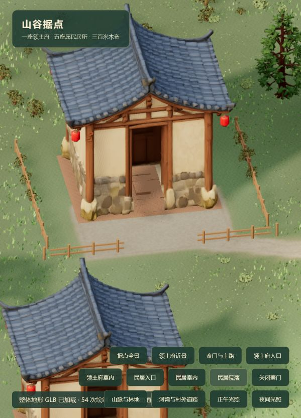

# 民居门前道路连接

2026-10-14：五条民居支路原来止于围栏附近，离实际门槛约 10 米。已补全该段，并为五座民居的门前院地加入与道路共用的踩踏土地遮罩、自然边缘过渡。草甸和实例草丛、随机灌木均避让该道路遮罩。

重新生成统一地形 GLB 与 manifest，LANDSCAPE_REVISION=4；顶点 452929、三角形 903168，未增加道路覆盖平面或改变地形高度。建筑和存档未重置。

相关道路、植被、导航、房屋、地形模型与剔除测试通过，最终一组 24 项通过；`npm run build` 通过，保留既有主包体积提示。内置 Chromium 同一局域网地址的独立预览已检查门槛至院门的道路连续性。

