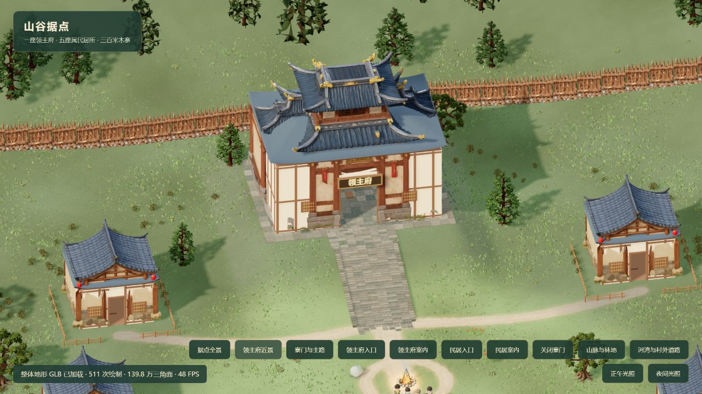
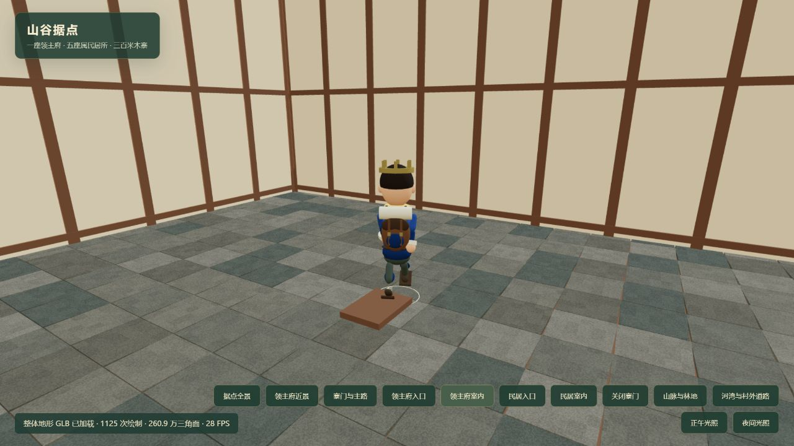
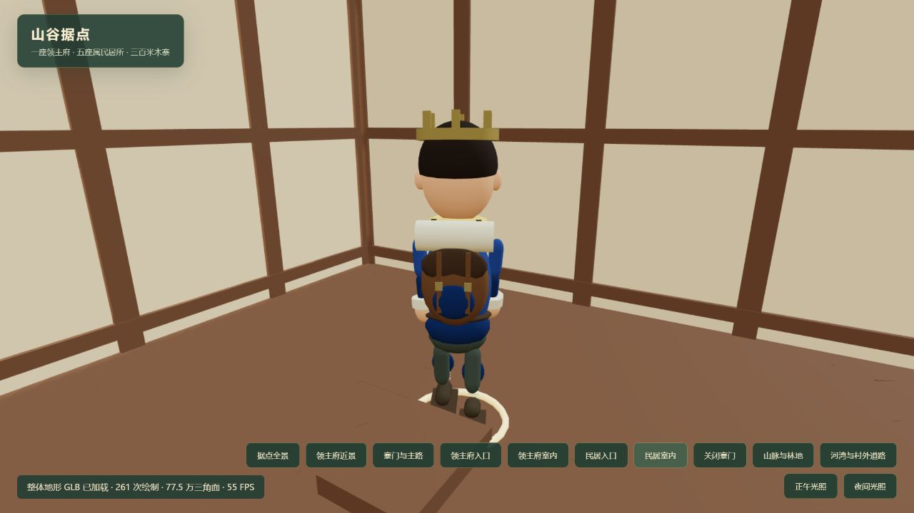

# 大屏性能、天气与完整房间验收

日期：2026-10-14。补充并限制 `validation-performance.md` 中小尺寸、固定天气的结论。

## 实施范围

- WASD 使用物理 `KeyboardEvent.code`，兼容中文输入法的 `Process`、`Unidentified`；输入框、弹窗和失焦停止规则保留。
- 雨、风叶、风线跟随当前视野，使用实际地形高度；闪电以实际落点地面为基准。原来固定在旧营地平面上的粒子在扩展世界会落入地下。
- 真实植物模型接入 GPU 风动画；动画时钟按快照实际接收间隔推进，最多外推 350ms，不代替服务端模拟。
- 连续地形按 128m、草地按 48m 分块剔除，保留三角形和顶点数据。新增墙板、梁柱按每栋房屋和材质合并绘制。
- 基础 3D 缓冲区限制约 180 万像素。模型预热 8 秒后，每两个统计窗口调整画质；低于 26 FPS 逐步降低线性分辨率至基础值的 65%，高于 52 FPS 逐步恢复。HTML 界面不降分辨率，天气效果不关闭。低画质阴影使用 1024px，否则 2048px；阴影更新 10Hz，领主视角阴影范围 170m。
- 民居墙高 15、门高 11、屋脊高 27；领主府墙高 26、门高 16、屋脊高 48。原模型是带侧墙的门楼，运行时从派生几何体挖出完整房间，并将纹理门面移到外缘，补上连续下层屋顶。源 GLB 未改写。
- 房间内侧范围对应整栋房屋占地：领主府约 54×38，民居约 24×20（扣除墙厚）。补齐地板、后墙、天花与梁柱；领主府入口文字为“领主府”。

## 验证证据和限制

目标为用户提供的 `http://192.168.2.248:5173/`。浏览器桥接可用的是 Codex 内置 Chromium，不是用户当前 Chrome 的登录会话。测试使用独立 Cookie 对应的测试世界；没有重置用户存档。

- 真实页面按住 D 约 1.2 秒，权威位置从 (38.448,64.832) 到 (47.051,60.570)，随后连续采样位置保持不变。
- 在真实页面发出 `key=Process, code=KeyW, isComposing=true`，权威位置确实变化；用 `Unidentified/KeyW` 松键后最终停在 (42.789,51.968)。松键涉及请求和快照延迟，不宣称零延迟。
- 自动天气采到雨粒子 359、风粒子 60、闪电强度 .227，后续衰减到 .073；没有通过关闭天气获得帧率。
- 2879×1505 CSS 视口、测试页保持前台时，暴雨领主视角短采样预热后约 35–48 FPS（首窗口 32）。雨粒子 449、风粒子 60；自适应渲染比例 .419，实际 3D 缓冲区 1206×630。高负载时清晰度有所下降；不宣称全分辨率稳定 60 FPS。
- 曾采到约 1 FPS，但进一步采样显示 CPU 大量空闲、浏览器帧回调约 1Hz。将页面置前后帧回调恢复，故该后台调度结果不作为前台渲染性能结论。前台短采样也不能代表所有硬件、天气与相机位置。
- 独立房屋预览确认外观、牌匾、完整大厅及民居空间。几何体回归检查身体不同高度穿过门口、多个纵向位置横穿房间、后墙封闭、屋顶多点覆盖，以及房屋网格总数少于 150。

验证命令：完整串行回归 `npm test -- --maxWorkers=1 --testTimeout=20000`：72 文件、577 项通过。随后新增自适应画质断言，`npx vitest run tests/render-budget.test.ts --maxWorkers=1`：3 项通过。未修改默认测试时限；默认 5 秒时限的一项既有长模拟用例曾超时。

最终 `npm run build` 通过；Vite 仍提示主包大于 500kB，该加载体积警告未作为帧率问题已经完全解决的证据。

## 服务与存档

更新了服务端使用的房屋门洞参数，已备份 SQLite 后重启世界服务。备份为项目内 `data/backups/world-before-habitable-homes-1791972089717.sqlite`，未改表结构；新服务健康检查返回正确项目根目录、errors=0。没有清空或新建替换用户世界。回退运行代码时应同步房屋渲染和碰撞定义，备份仅在需要恢复时使用。

## 画面

