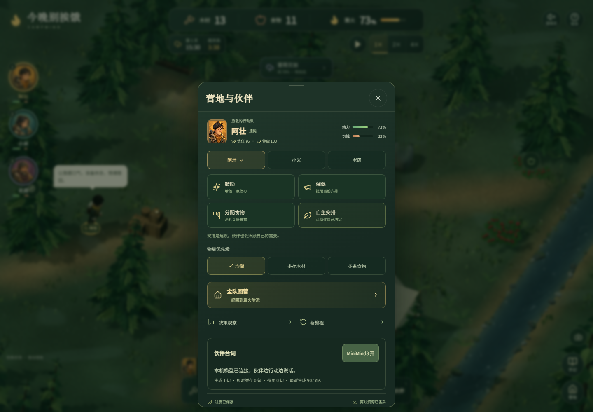

# MiniMind3 台词接入验证（2026-10-12）

## 本机路径与启动

`minimind3/` 已由游戏仓库的同级目录移入仓库。移动前后核对 111 个文件、395,186,540 字节相同。GGUF、DLL、训练权重和数据留在本机并由 Git 忽略；训练源码和现有 Apache-2.0 许可证随源码保存。

`python minimind3/setup_assets.py --check-only` 校验 26/26 个固定文件。上游模型 LFS 元数据与本机 68,189,920 字节 GGUF 的 SHA-256 一致；Ollama 客户端确认 0.40.3。未重新下载完整运行库 ZIP，也未执行从零资产恢复；官方 ZIP 约 1.47 GB，脚本验证归档和每个 DLL 后提取 CPU 运行文件。

启动器在端口 5180 实测成功启动游戏、复用已有模型服务，`/npc-api/health` 正常；退出该启动器后端口 5180 关闭，复用的 8765 服务仍在。新建模型进程的清理路径经过代码复核。

## 真实推理与响应边界

- 使用实际本地 GGUF 和 Ollama CPU DLL，没有远程模型或模拟答案。
- 原始自由改写曾输出相互矛盾的天气描述，因此当前采用与事件匹配的第一人称动作前缀，让模型续写后半句。拒绝超长、重复、思考标签、部分跑题和明显矛盾表达。
- 批量提示词预填充替代逐 token 预填充，保持输出 UTF-8 增量解码。
- 同源 Vite 代理抽测（调整跳过协议前）：10 次休息事件请求，9 次通过检查、1 次未通过内容检查（当时返回 422，现改为 HTTP 200 跳过结果）；通过者的原生生成耗时 78–125 ms，HTTP 端到端约 92–123 ms。
- 同时运行软件 WebGL 浏览器回归时，曾测得约 0.3–1.4 秒原生生成时间。此范围受 CPU 负载影响，不能承诺固定延迟；动作、现有气泡和受伤叫声先行，不等待模型。
- 真实模型浏览器测试看到选中 NPC 的 `data-speech-source=minimind3` 气泡，并检查营地连接状态。慢请求时模拟时间和真实 MLP 决策继续推进；暂停后迟到结果没有显示。
- 原生上下文实测：固定采样种子的小米请求，在穿插阿壮请求后产生相同结果；超时并清理后也产生相同结果。未出现 Unicode 替换字符。
- 内容检查是启发式过滤，仍会有不自然表达；复杂人设、长期记忆和创作质量尚未达到稳定验收，需要游戏数据微调。

## 自动检查

- TypeScript 单元测试覆盖慢请求、重开、暂停、死亡、受伤、状态变化、生成自触发、重复、离线、缓存命中和到期。
- Python 协议测试覆盖请求边界、思考输出、重复、明显矛盾，以及超时后在原生计算结束前仍保留推理锁。
- 新增浏览器测试：慢台词、断线开关、真实模型经代理显示，共 3 项通过。
- 最终 TypeScript 205 项、Python 5 项通过，生产构建通过（已有大包体积提示）。并行软件 WebGL 回归曾导致两个旧引擎用例超时，串行复跑全部通过。
- 完整浏览器回归 15 项通过、1 项真实模型测试按环境跳过、1 项天气测试因正常台词拒绝返回 422 而失败。修复后，慢请求、断线开关、真实模型、天气共 4 项针对性复跑通过。
- 可选服务未启动时代理返回 HTTP 200 的 unavailable 状态，客户端降级；离线真实代理与天气另行复跑，避免浏览器资源错误。
- 桌面实测截图：。
- 游戏源码差异检查通过；原样引入的上游训练源码保留已有行尾空白，不进行无关格式化。
