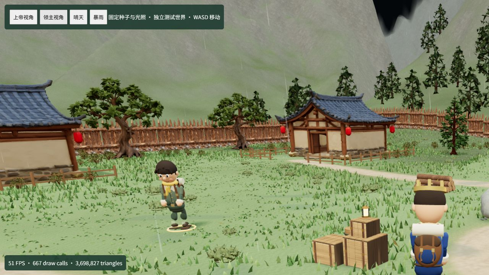

# 页面与领主视角性能优化验收

日期：2026-10-14。范围：前端雨效、静态模型剔除、世界快照进入 React 的更新成本。

## 已实施

- 静态房屋在拟合后建立 BVH，雨滴和第三人称相机只取最近交点。使用 indirect 索引，不改变源模型顶点、索引顺序、面数、材质或纹理；几何体释放时一并释放索引。仅挂到对应静态 Mesh，未覆盖 Three.js 全局原型。
- 静态屋顶复用完全相同射线的落点与法线，包括未命中结果，缓存上限 2048 条。屋顶列表、几何体对象、世界矩阵改变时清空；动态布料继续每帧实时求交。
- 庭院植物、草丛、河岸石块和寨墙按 48 米格子分组实例化，共享原几何体与材质，让相机及阴影视锥剔除画面外的批次。保留每个实例的原始位置、缩放与朝向。
- WorldClient 接收快照时复用内容未变化的状态分支，减少 React 对人物、历史和地形等大对象的重复处理。不会修改旧状态或传入的响应。
- 服务端模拟、位置权威、350ms 失联停止、输入队列与 300ms 旧输入丢弃规则均保留。

依赖：固定版本 `three-mesh-bvh@0.9.16`，API 参考其[官方仓库](https://github.com/gkjohnson/three-mesh-bvh)。

## 浏览器实测

环境：Codex 内置浏览器，1280×720，设备像素比 1.75，Vite 开发模式。模型加载与着色器预热完成后读取实际场景渲染统计；不是生产包或不同硬件上的帧率保证。

可复现测试页：`http://localhost:5173/scripts/performance-preview.html`。独立内存世界，不读写玩家存档。种子 17，初始模拟时间 210s、雨强 1、云量 .8、风强 .6、风向 .4。世界继续运行，采样位于白昼，光照强度 3.37；相机与领主位置保持相同。固定测试雨量和风，不覆盖所有自动天气转场。

| 固定暴雨场景 | 优化前 | 优化后 |
| --- | --- | --- |
| 领主视角实际渲染帧率 | 约 4 FPS | 预热后 47–51 FPS |
| 上帝视角实际渲染帧率 | 约 2 FPS | 一次稳定采样约 36 FPS |
| 领主视角提交三角形 | 4,883,973 | 3,698,827，减少约 24% |
| 领主视角绘制调用 | 533 | 667 |
| 雨效占 CPU 采样时间 | 27.76s / 33.98s，约 82% | 1.83s / 29.33s，约 6% |

空间分组增加了绘制调用，但减少了实际提交的模型面数；未将调用次数增加描述为下降。CPU 百分比来自不同长度的采样，反映热点占比，不能直接比较两段原始秒数。预热期间曾出现 13–24 FPS，未计入稳定帧率。

真实游戏页面另行验证（天气与时间自动推进，不作为上述固定场景的严格 A/B）：

- 主线程按键监听与渲染采样：一次 D 按键从 keydown 到权威位置可见变化约 130.4ms，按住约 1.04s。
- 连续按住 A 约 2s 期间，收到 7 次可见权威位置更新；松键 500ms 后的采样位置保持不变。
- 真实页面采样约 39–48 FPS，移动期间有约 29 FPS 的窗口；仍会受自动天气、相机位置、开发模式及设备负载影响，未宣称全程稳定 60 FPS。
- 快照复用后的短采样中 React 占用约 6.5%；复用前一次短采样约 12%。这两次自动天气和时间不同，作为补充观察；对象身份与数值正确性由回归测试覆盖。
- 临时输入监听器、采样对象和 CPU profiler 已清理；临时浏览器页已关闭。

画面证据：

## 回归验证

新增回归：

- `static-raycast.test.ts`：密集屋顶每条雨线不再读取全部 98,304 个顶点；验证原索引不变、原点重定位后的交点和法线与普通 Raycaster 一致。
- `rain-query-cache.test.ts`：100 帧完全相同的静态落点只做一次求交；屋顶移动、模型替换后重算；动态布料不缓存；不同雨向不混用。
- `model-culling.test.ts`：远处实例被视锥剔除，原实例位置与共享几何体不变。
- `world-snapshot-sharing.test.ts`：未变状态复用对象、实际变化正确发布、旧状态保持原值、完整序列化值不变。

首次默认 `npm test` 在同时构建及大量工作进程争用 CPU 时，`vegetation.test.ts` 1 项、`weather.test.ts` 2 项、`late-recall.test.ts` 1 项超时。第一阶段改为 `npm test -- --maxWorkers=2` 后，64 文件、566 项全部通过。

补入快照复用后，全量测试与构建同时运行时，`engine.test.ts` 的 `continues through real actions and records neglected survival deaths without ending the world`、`rejects broken policy outputs and keeps histories, stats and resources finite` 两项触发 5 秒超时。最终改为构建完成后单独运行 `npm test -- --maxWorkers=1`。未修改超时门槛或删减测试；验证记录中保留这些并发时的失败。

最终结果：`npm test -- --maxWorkers=1` 65 文件、567 项全部通过，耗时 66.23s；`npm run build` 成功；修改范围的 `git diff --check` 通过。

构建保留 Vite 大于 500kB 的产物提示；本次重点为交互期性能，未将首次加载和产物拆包声明为已优化。
