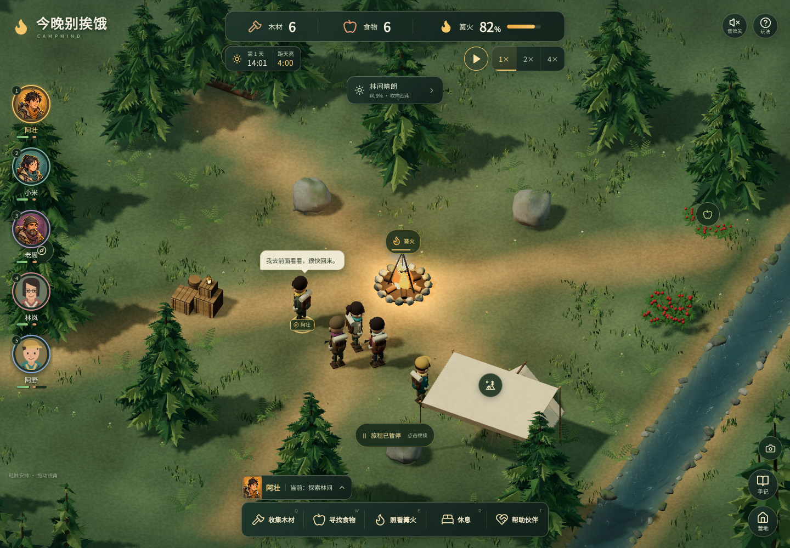
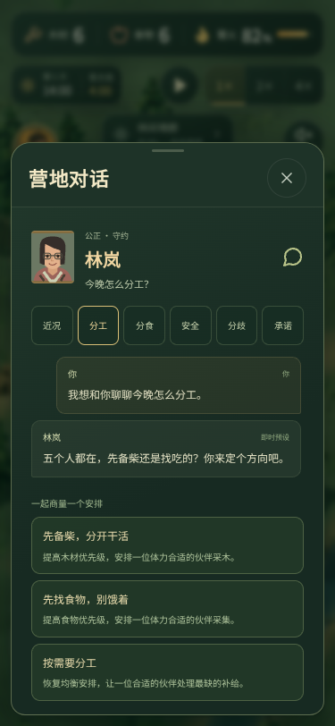

# 五人性格与玩家互动：升级和验证

日期：2026-10-12。基于 `279e560c24e7a1a0ea41be4861fbc4420b4042b2`（已经合入 MiniMind3 台词服务的 main）升级。此前的美术和天气验证保存在 [历史记录](validation.md)。

## 本次改变

玩家继续担任营地领队。保留原有 3D 森林、物理、天气、240 秒夜晚和手机浮动操作区，增加林岚、阿野，并把五位伙伴的需要接到玩家可以回应、协商和落实的安排中。

| 伙伴 | 性格导致的玩法问题 | 可落实的干预 |
| --- | --- | --- |
| 阿壮 | 愿意承担，重视付出被看见，工作负担高时仍会想撑下去 | 认可贡献、安排休息、找合适的人接一轮工作 |
| 小米 | 对风雨、淋湿和风险更敏感 | 讨论安全，去雨棚休息或在近处照看篝火 |
| 老周 | 热心照顾受伤伙伴，同时可能忽略自己的体力 | 指定真实受助者，决定自己照顾或交给另一位合适的帮手 |
| 林岚 | 对工作差距、含糊安排和失约更敏感 | 公开商量轮班，作出有期限的补偿承诺，接受未解决分工的后果 |
| 阿野 | 重视自主与新发现，希望自己的建议得到考虑 | 同意一趟有边界的探索，安排返营或休息；超时探索会实际召回 |

主动请求来自实际模拟状态与人格权重。开场约 8 秒询问分工；此后的全局主动请求间隔至少 18 秒，并有个人冷却，同时最多两件未处理请求。同一场分工争议合并处理，未回复不会冻结 NPC 的自主生存行为。玩家可以从伙伴档案主动发起六类话题，也可以直接回应轻量提示。

对话里的三个选项重新检查当前库存、人手与安全。结果会改变真实工作、资源、信任、不满、伙伴关系、约定和记忆。餐食与休息承诺以实际消费或完成行动为准，暂停冻结期限，重复点击不重复扣粮或发奖，失约不会被晚来的补救抹掉。指定帮助对象已恢复时，不能改帮另一个人后冒称完成原约定。换班考虑被释放的工作位，不会清空其他人已有的相同行动进度。

## 模型与模拟器的职责

- 任务模型继续使用现有 41 维 v2 MLP，权重未变，也没有宣称重新训练五人社交模型。同伴数量特征仍按原训练单位「人数 / 2，最多为 1」编码。
- 新的五项社交人格偏好用于选择请求、解释需要和调节社交反应；它们没有冒充 MLP 新学到的输入特征。
- 玩家明确商定的一轮任务由受安全条件约束的规则执行，决策面板标明 `rules` 和约定原因。其余任务仍经过原策略接口。
- MiniMind3 接收固定性格、当前需要、话题、本人已知记忆和最新玩家文本，生成展示用台词。文本不能写入物资、命令、承诺或关系结果。
- 每条请求绑定人物、旅程生命周期、线程、台词 ID 和语义版本。连续发送、暂停、切后台、关闭窗口、换话题和重新开局都会正确保留或取消对应工作。
- 服务忙时当前社交消息最多重试两次；不合适的生成保留即时预设，不无限重试。客户端展示真实来源。

## 实际验证

| 检查 | 结果与范围 |
| --- | --- |
| `npm test` | **301 / 301 通过，17 个文件**；最后一次完整运行 11.34 秒 |
| `npm run test:npc` | **8 / 8 通过**；Python 请求、五人身份、上下文、清理与串行行为 |
| `npm run build` | TypeScript、Vite、离线清单生成成功；最终缓存标识 `530402ad85e15a54` |
| 新增社交 Playwright | **4 / 4 通过**；主动提示、主动交流、三选项、聊天、实际安排、记忆、暂停恢复、375×812 与 844×390 操作 |
| 补充 UI 回归 | 已选择的 3 条原有用例通过；覆盖桌面暂停操作和手机横竖屏的真实 3D 地图操作；完成选择后的话题冷却提示另作定点验证 |
| 实际图像检查 | 1440×1000、375×812、844×390、360×640；五人均可选择，界面无横向溢出、无页面运行错误，对话可内部滚动 |
| 独立代码审查 | 重要问题已修复并通过定点复审；包括指定受助者、换班、迟到回复、群体事件去重和实际期限 |
| `git diff --check` | 通过 |

测试采用真实 `issueCommand`、`advanceGame` 和存档接口。针对发现的问题先复现失败，再验证修复：重复分食、共享库存竞争、吃饭与休息真实兑现、失约一次记账、私人记忆、超时送货、探索强制返营、进行中的身体安全复查、已恢复的伤员、工作位交接及暂停中连续聊天都包含在回归中。

五人返营形成密集人群时，原有左右小角度绕行会把前往帐篷的伙伴夹在中间。新增有限的大角度逃离检查解决该拥堵，并保留手动走到伙伴身边的原有行为。原始休息路径回归没有靠移动初始人物或延长期限来绕过问题；现有火焰、溪水、受伤、对向行走与手动目的地检查继续通过。

旧三人档保留原人物、在途任务、物资、随机状态、事件文字和历史 36 / 41 维决策，补入两位新伙伴并初始化空社交历史。当前五人社交档严格校验五人名单、20 条唯一有向关系、计数器、时间、消息来源、内存边界与已裁剪历史引用；损坏的新档不会冒充旧档迁移。

## 回合评估与限制

[14 局真实评估](evaluation-social.md)及[完整 JSON](evaluation-social.json)记录了五人引擎在固定种子、场景、难度、策略与救援控制器下的运行。普通难度样本中两种策略各 3/3 胜利；严酷难度无人指挥及两局救援均因篝火熄灭失败。3,000 次决策没有异常回退。该控制器没有执行社交选择，不能用来证明新社交玩法更有趣或模型优于规则，也不是重新训练的成绩。报告保留实际运行版本的源码哈希；评估完成后的开场去重与完整承诺期限保护不在该报告快照内。

浏览器验证环境为 Linux x64、Chromium 153、SwiftShader WebGL2。手机是触摸视口仿真，没有宣称已测试 iOS / Android 真机、长期发热或真实设备帧率。完整生产构建保留既有大块 Three.js 资源，Vite 仍提示主 JS 块大于 500 kB；构建本身成功。

**没有在本环境运行真实 MiniMind3 权重推理。** 当前 Linux 检查环境没有 GGUF / Windows DLL，原 ctypes 运行时仍依赖 Windows。已检查并扩展其接入代码、请求协议和异步生命周期，没有修改 ABI 或伪造模型生成速度、生成质量与新上下文的实际成功率。继续使用原来的 `npm run npc:setup`、`npm run dev:local` 在具备资产的 Windows 环境启动。无服务时仍可完整使用五人互动与即时预设。

远端完整检查、提交与合并状态以仓库 [Game checks](https://github.com/kelicblan/ai_control_games/actions) 和对应 PR 为准，本页的通过数字只描述已经实际执行的本地检查。

## 实际画面

