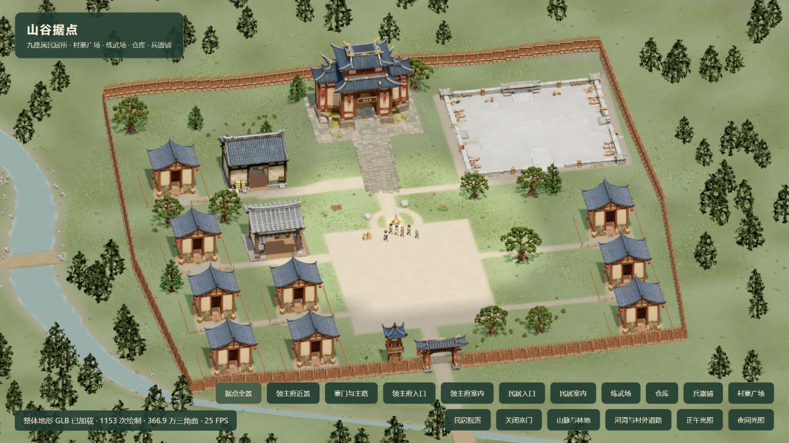

# 村寨功能分区验收记录

日期：2026-10-15。用户确认彩色标注图布局后实施。

## 交付

- 北侧领主府、南侧寨门和寨墙轮廓保留。
- 9 栋属民民居：西侧外列 4 栋、内列下方 2 栋；东侧下方 3 栋。原五位属民的稳定住房 ID 和身份保留，额外房屋不创建新属民。
- 东北侧练武场，西北内侧仓库，仓库南侧兵器铺，中南部村寨广场。
- 支路、门前地面、广场与练武场地面纳入真实地形蓝图，重建地形 GLB，地形 revision=5；模型 URL 带版本参数。
- 仓库作为新地图建筑接入。原核心补给点保留在广场北缘 `(32,67)`，吃饭与返送点保持 `(32+座位偏移,72)`，避免把旧采集经济迁到西北仓库后引入长途绕行。
- 建筑碰撞按实际生成 GLB 的墙面标定，与屋檐和底座外包围盒区分；门口保持原模型中心，支持非对称前墙。
- 仓库和兵器铺参与屋顶雨水检测及天气遮盖；练武场中央露天。室内裁剪、镜头射线和物理使用同一组墙面参数。
- 人物恢复区保留原篝火范围与住房内部，仅补上新公共屋舍；没有将整个寨内草地扩为恢复区，也没有修改 MLP 输入、策略权重或生存阈值。
- 练武场的不平整底座适配为薄板，保留来源 GLB 和全部三角形，避免地形穿插；公共建筑地板高于地形 0.10m，消除共面闪烁。
- 地图存档布局版本为 7，兼容原版本及实施过程中的版本 5、6；修复新墙体覆盖位置与旧任务目标，保留进度、库存、历史、人物状态，不复活死亡角色。

## Tripo 实际账单

全部为单步 `POST /v3/generation/text-to-model`，`tripo-v3.1` / `v3.1-20260211`，20,000 面预算，纹理/PBR 开启；没有额外转换或付费重试。

| 资产 | 任务 ID | 实际费用 |
| --- | --- | --- |
| 练武场 | 655b470a-1502-43f3-8e65-7ca439a02357 | 20 积分 |
| 仓库 | 52bbdf37-f834-4c29-a4bf-0eaab3525e26 | 20 积分 |
| 兵器铺 | 947fbf29-007a-48e6-90fe-bd718eb20208 | 20 积分 |

总计 60 积分。生成后余额查询：300，冻结 0。

运行资产：`public/assets/models/valley/{training-ground,warehouse,weaponsmith}/model.glb`，各附 `preview.png`、`task.json`。完整下载来源归档在项目内 `data/tripo-village-expansion-originals/tripo-out/`，避免原始下载副本重复进入生产包和离线缓存。

## 数据与运行边界

迁移前通过 SQLite 原生在线备份保存 `data/world-before-village-layout-20261015.sqlite`。服务仍使用原 `data/world.sqlite`；未清库、未重置玩家、未推送或发布远程站点。

迁移接口读回每份世界五位属民；读取成功不代表原存档中的死亡属民应恢复。最终服务健康错误数 0；实际玩家世界 GET 返回 HTTP 200、布局版本 7、属民数 5、catchingUp=false。暂停世界的转换可在内存读回，下一次保存落盘；重复恢复幂等。

## 浏览器证据

本地桌面预览：`http://127.0.0.1:5173/scripts/valley-preview.html`。此页使用独立内存场景，不保存或更改玩家游戏；共享实际游戏渲染、地形、资产和布局。

全景确认九栋民居位置、三个新模型、广场和主轴。生成模型与地形加载标识均为 ready；修复生成建筑 GLSL 浮点常量错误后，没有新的着色器编译错误。历史日志中的修复前错误不作为当前状态。

## 验证进度

- 构建 `npm run build` 通过，保留原有大于 500KB 的产物提示。
- 独立复核通过：实际墙面、非对称门洞、迁移、清空范围、模型生命周期无剩余阻断项。
- 最终定向回归：12 文件、224 项全部通过，覆盖九栋房屋实际导航、公共设施、真实模型墙面/门洞、天气保护、补给流程、版本 7 迁移、完整存档校验、物理和召回。命令为 `npx vitest run tests/village tests/settlement-migration.test.ts tests/persistence.test.ts tests/physics.test.ts tests/weather-policy.test.ts tests/habitable-homes.test.ts tests/world-navigation.test.ts tests/late-recall.test.ts --maxWorkers=1 --testTimeout=30000`。仅该次命令使用 30 秒全局测试预算，没有修改源文件默认超时；召回用例保持自身 20 秒预算并在 12.93 秒通过。
- 较早一轮定向回归：13 文件，233 项通过、1 项召回长时模拟触发其原有 20 秒超时；该失败保留，最终单独序列化复验已通过。
- 实施过程中的全量回归：86 文件，656 通过、13 失败。旧坐标、旧房屋数、露天/屋内测试点、临时练武场碰撞等失败均已逐项修正并单独复验；不把该过程记录称为全量通过。
- 最终布局与原补给流程的独立精确三天模拟：1,800 秒、5 位属民全部存活，最低健康 78.97，采集食物 44、实际吃饭 50 次，存档结构校验通过；采样中没有停滞路线或滞留物资。
- 现有三天测试仍要求采集食物至少 50，新布局得到 44，保留为未通过项，没有降低阈值或调整 AI 权重。实际存活与物资守恒证据单独报告，不把这一数值差异称为无关基线失败。

仓库、兵器铺与练武场近景分别保存为 `docs/screenshots/village-warehouse-20261015.png`、`village-weaponsmith-20261015.png`、`village-training-ground-20261015.png`。
