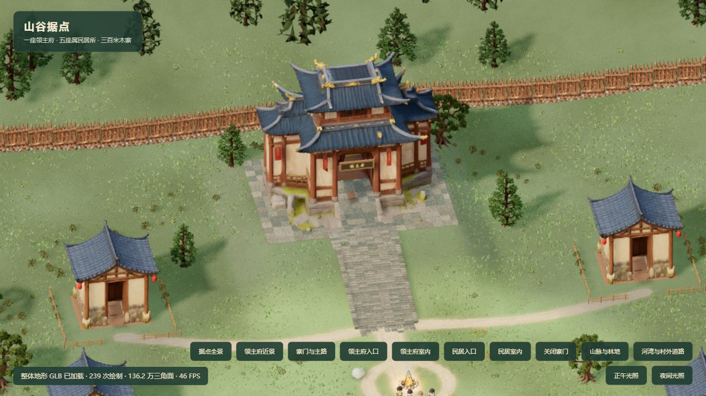
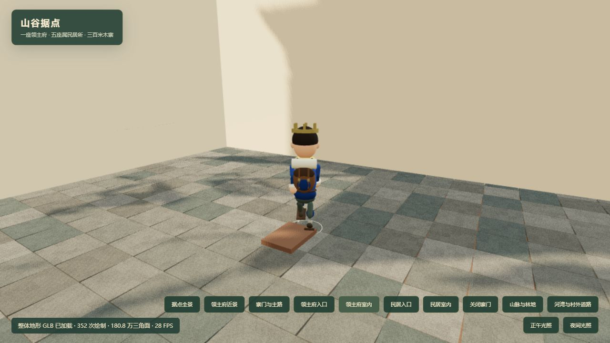
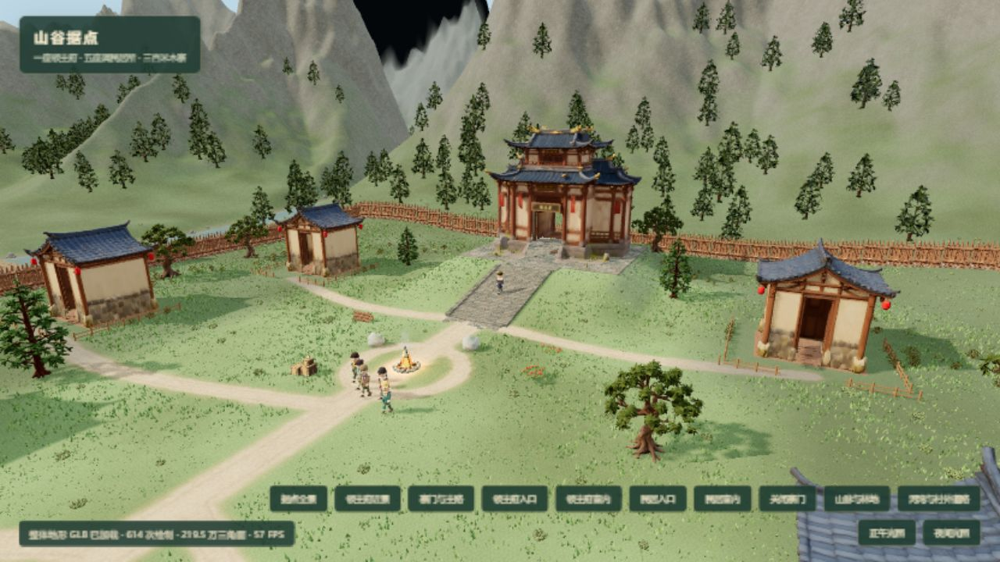

# 缩远范围、建筑外观与濒死救治

日期：2026-10-14。

## 范围与规则

- 领主相机最大距离从 48 增至 160，滚轮和相机配置共用同一常量。保留近距离下限、地形抬升和建筑避障。
- 取消上一版门面水平挤压、外部格子框架和叠加的可见平顶。保留原 GLB 的水平外形、屋檐、纹理和立柱；只调整竖向高度。没有改动道路或地形资产。
- 完整室内使用朝内墙面和天花。相机进入室内后，材质剔除原门楼占据室内的墙体；独立空心射线几何体保持横向通行和相机避障。外部相机看原外观，室内相机看完整房间。天气使用隐藏的完整屋顶包络。
- 牌匾从 14.8×4.2 调整为 11.4×3.2；字幅从 184px 调整为 128px，三字分别定位，楷体并保留上下、左右边距。
- 用户明确选择“只把濒死改成可救治，已死亡的伙伴不复活”。不修改现有死亡标记、不自动复活、不重置世界。
- 新增 `rescue` 权威命令：仅对仍活着且 `0 < health <= 25` 的 NPC 生效，消耗 2 份食物，恢复至 40 健康、至少 25 精力、缓解 45 饥饿并清除受伤。缺粮、健康 0、已死亡或不濒死时不会花费食物。
- UI 区分“已去世”和“濒死 · 可救治”；濒死者详情出现救治按钮，死者详情说明不能唤醒，也不再显示冻结的“自行休息”当前态度。

## 原因调查

只读检查当前 SQLite 最新快照，多个长时间世界中的五名伙伴均为 alive=false、health=0、hunger=100，food=0。引擎在 hunger>=88 时持续扣健康，健康耗尽进入永久死亡；世界服务会离线继续推进。故当前躺倒者不是正常睡眠，不能用休息或任务命令唤醒。没有完整的早期死亡时间线，未断言所有伤害均来自某一种天气或某一条具体命令。

## 验收证据

- 使用同一局域网 URL 的内置 Chromium，独立于用户 Chrome Cookie。房屋预览是独立内存世界，不写存档。
- 桌面宽屏视口下，真实滚轮操作将 `cameraDistance` 推至 160；截图可同时看到领主府、多个民居和营地道路。
- 截图检查确认取消扩展方盒外观，原重檐、立柱和门面恢复；完整大厅仍可显示。回归检查多个身体高度穿门、多个纵向位置横穿房间、封闭后墙、屋顶覆盖，以及室内/室外材质切换。
- 实际游戏详情显示“已去世，并非睡着，无法唤醒或救治”。没有将真实存档中的死者改成濒死来演示救治。
- 救治测试覆盖纯模拟、食物不足、不可复活边界、重复命令幂等性、服务端协议接收与 SQLite 重开后的状态持久化。

新增服务命令后，使用 `VACUUM INTO` 备份到 `data/backups/world-before-triage-1791979648458.sqlite`，再重启同一数据库的世界服务。健康检查 service=campmind-world-v1、root 正确、errors=0；没有表结构迁移。

最终验证：`npm test -- --maxWorkers=1 --testTimeout=20000`，75 文件、590 项全部通过；`npm run build` 通过。Vite 仍有主包超过 500kB 的体积提示。此处没有重新承诺所有大视野、天气下的稳定帧率。

